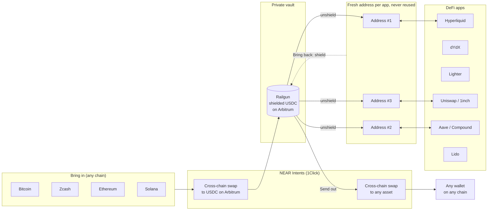
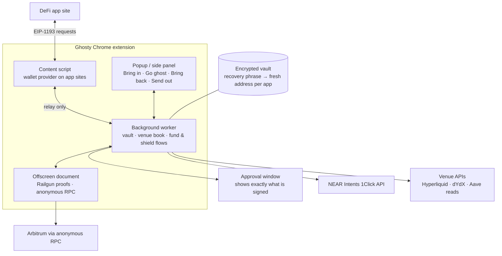

# Ghosty

**Trade anywhere in DeFi. Leave no trace.**

## The problem

**Everything you do on-chain is public.** One wallet address ties together your
balance, every trade, every position and every app you use. Anyone (a
competitor, a bot, a stranger) can follow it forever.

**Privacy tools don't reach the apps people use.** Shielded pools like
Railgun, Privacy Pools and Zcash can hide a balance, but the moment you want
to trade on Hyperliquid, lend on Aave or swap on Uniswap, you have to bring
funds back to a public wallet. That wallet then becomes the link between your
private money and your activity.

**There is no single wallet that does this everywhere.**

## How Ghosty works

Think of Ghosty as a **private vault with disposable doors**.

**1. Your money lives in a private vault.**
Your funds are kept in a shielded pool (Railgun). From the outside,
no one can see how much is inside or whose it is.

**2. Every app gets its own new door.**
Want to trade on Hyperliquid or lend on Aave? Ghosty opens a brand-new
door, a fresh address that has never been seen before, and sends just
what you need through it. You use the app exactly as you normally
would.

**3. When you're done, the door disappears.**
Ghosty brings everything back into the vault and never opens that
door again. Your next app gets a different door. No two can be
linked to each other, or to you.

**4. One extension, all of DeFi.**
You don't need a different trick for every app. Ghosty works on
Lighter, Uniswap, Compound, Hyperliquid, 1inch, Aave, dYdX and Lido.



## Any chain in, any chain out, with NEAR Intents

- **Bring in:** deposit from Bitcoin, Zcash, Ethereum, Solana and more.
  NEAR Intents swaps it to USDC on Arbitrum, and Ghosty shields it straight away.
- **Send out:** pay out from the shielded balance to any asset on any chain
  NEAR Intents supports, delivered to the address you choose.
- **Confidential swaps:** with your own 1Click partner key, Ghosty uses the
  NEAR Intents Confidential Swap API.
- **Lido:** NEAR Intents also turns shielded USDC into ETH on a fresh address,
  ready to stake.

Your money never sits in a public wallet you own. Getting in, using DeFi and
getting out all run through addresses that can't be tied back to you.

## Try it

1. Download the latest release zip and unzip it.
2. Open `chrome://extensions`, turn on **Developer mode**, click
   **Load unpacked** and pick the unzipped folder.
3. Create a vault (password of 8+ characters) and write down the recovery phrase.
4. **Bring in** funds from any chain, then **Go ghost** on any supported app.

Build from source:

```bash
pnpm install
pnpm build        # output in .output/chrome-mv3
```

## Architecture



## Security

- **Your keys never leave the extension.** The recovery phrase is encrypted
  with your password, and every address is derived from it, so all funds can
  be recovered from the phrase alone.
- **Sites can only ask, never act.** App pages talk to Ghosty through a relay;
  only Ghosty's own screens can unlock, fund or send.
- **You see exactly what you sign.** The approval window shows only the
  signed fields, and flags unlimited approvals.
- **Nothing is shielded early.** Bring back refuses while an app still holds
  your funds or money is still on its way.

## Built with

Railgun SDK · Privacy Pools SDK (0xbow) · NEAR Intents 1Click API · viem ·
WXT · React · anon-rpc · noble / scure crypto libraries.

Parts of this code were written with AI coding assistants.

## License

See [LICENSE](LICENSE).
